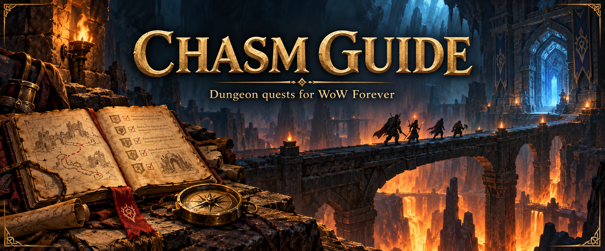
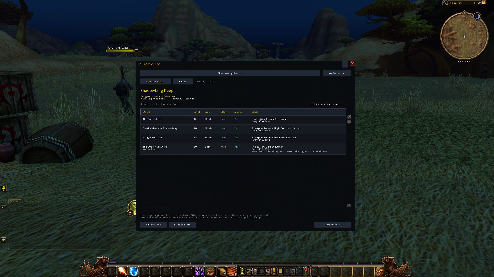
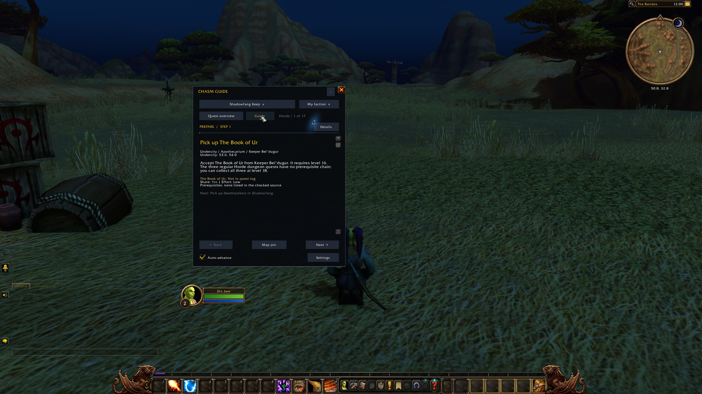
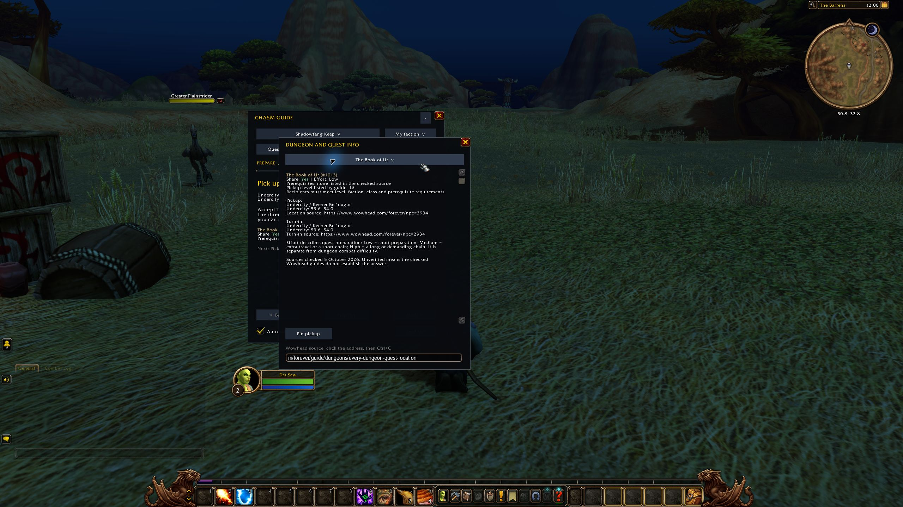

# Chasm Guide

Get your dungeon quests sorted before the group heads inside.

Chasm Guide shows which quests to pick up, where to get them and what you need to do first. Pick a dungeon, check the quests for your faction, then follow the guide through pickups, objectives and turn-ins. Your place is saved between sessions.

**[Download Chasm Guide](https://github.com/DeanieBobeanie/ChasmGuide/releases/tag/v1.3.0-beta.1)** · [Report a problem](https://github.com/DeanieBobeanie/ChasmGuide/issues)

## Install

1. Download the addon ZIP from the release page and extract it.
2. Put the `ChasmGuide` folder in your WoW Forever `Interface/AddOns` folder.
3. Restart WoW and enable **Chasm Guide** in the AddOns menu at character selection.

The final path should be `Interface/AddOns/ChasmGuide/ChasmGuide.toc`.

When updating, replace the addon folder and keep your `WTF` folder to retain your progress and settings. Made for WoW Forever 1.60.1. TomTom is optional.

## Using the guide

Type `/cguide`, choose a dungeon and leave the faction set to **My faction** to see your quests.

- Check quest levels, pickup locations, prerequisites and sharing information before you travel.
- Click a quest for details, or right-click it to pin the pickup location.
- Tick **Include chain quests** to see the preparation quests too.
- Click **Start guide** to follow the steps. **Quest overview** takes you back to the list without losing your place.
- Drag the title bar to move the window, or use **−** to tuck it away while you play.

Open **Settings** or type `/cguide config` to enable the waypoint arrow or automatic quest acceptance and turn-ins. These start switched off. Hold **Shift** to pause quest automation; reward choices are yours to make.

## In game

**Check your quests before the run.** Shadowfang Keep's Horde overview shows pickup locations, levels and which quests can be shared.

See the step-by-step guide and quest details

**Follow the next step.** The guide keeps the current pickup, location and quest status together.

**Look up a quest.** Open Details for pickup and turn-in locations, requirements and source links.

## Handy commands

| Command | What it does |
| --- | --- |
| `/cguide` | Show or hide the guide |
| `/cguide config` | Open settings |
| `/cguide overview` | Open the quest list |
| `/cguide restart` | Restart the route at its first unfinished step |
| `/cguide resetpos` | Bring the window back to the centre |

There are dungeon shortcuts too, including `/cguide wc`, `/cguide dm` and `/cguide sfk`. The [player guide](ChasmGuide/README.md) has the full controls and route details.

## Credits

Chasm Guide by [DeanieBobeanie](https://github.com/DeanieBobeanie), with contributions from [Hacker--x](https://github.com/Hacker--x).

Quest data includes records from [QuestieDB](https://github.com/Questie/QuestieDB). See the [source and licence notices](ChasmGuide/THIRD-PARTY-NOTICES.md).

Found a wrong pickup or a missing quest? [Open an issue](https://github.com/DeanieBobeanie/ChasmGuide/issues) with the dungeon, faction and what happened. Pull requests are welcome; see [Contributing](CONTRIBUTING.md).
