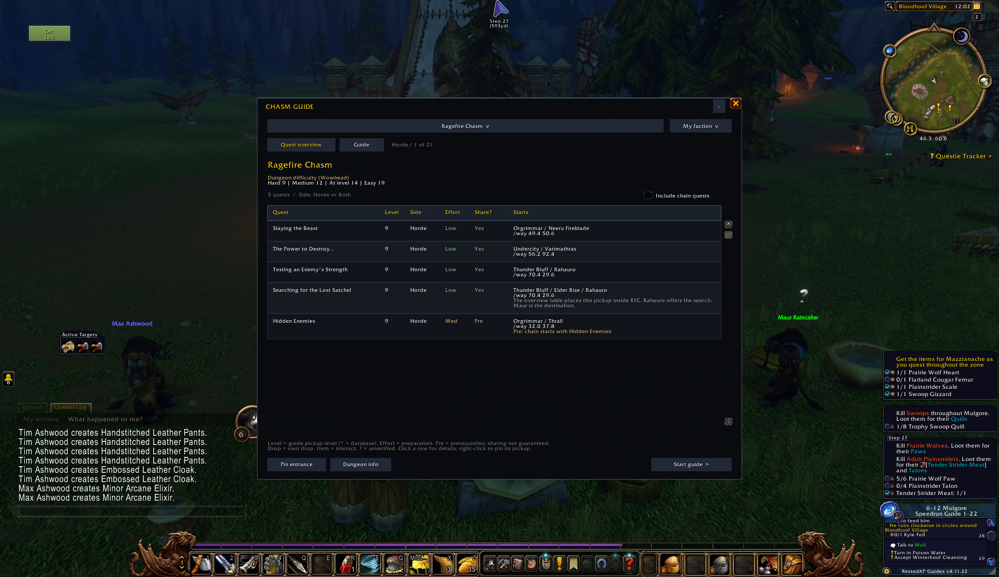

# Chasm Guide

Dungeon quest checklists for WoW Forever, with faction filters, pickup locations, prerequisites and step-by-step routes.

[Download the beta](https://github.com/DeanieBobeanie/ChasmGuide/releases/tag/v1.3.0-beta.1) | [Report a problem](https://github.com/DeanieBobeanie/ChasmGuide/issues)

## Install

Download the release ZIP and copy its `ChasmGuide` folder into your client's `Interface/AddOns` folder. The path should end in `ChasmGuide/ChasmGuide.toc`. Fully restart WoW, then enable Chasm Guide at character selection. Keep your WTF folder when updating to preserve progress and settings.

This beta targets WoW Forever 1.60.1, interface 16001. TomTom is optional. The package contains the standalone ChasmGuide add-on.

## Quick start

Type `/cguide` to open the dungeon browser. Choose a dungeon and faction, review the quest table, then select **Start guide**. Click a quest for details, or right-click it to pin its pickup. Type `/cguide config` for settings.

- Browse quest levels, pickup locations, prerequisites and faction requirements before a run.
- Track pickup, objective and turn-in steps, with saved progress between sessions.
- Use optional waypoint navigation and quest automation. Both default to off. Reward choices remain manual, and holding Shift pauses automation.
- Review City of Dalaran routes for each faction and the Alliance Scarlet Monastery quest Past Due.

Use `/cguide restart` to revisit an updated route. See the [full player guide](ChasmGuide/README.md) for controls, route details and source links.

## In-game screenshot

The Ragefire Chasm quest overview lists pickup locations, quest levels, prerequisites and sharing information before a dungeon run.

## Beta limits

The catalog has 28 dungeon entries. Five are planning entries without verified playable routes. A catalog entry does not mean that dungeon is currently open or tested. Interior directions and quest interactions still need checks in the game.

The automated checks use mocked WoW APIs and Lua 5.1. They cover route progression, faction filters, UI handlers and saved-progress migrations. They do not replace a live run through each dungeon.

## Credits and contribution

Thanks to [Hacker--x](https://github.com/Hacker--x) for contributing an update to Chasm Guide.

Quest metadata includes a factual snapshot derived from [QuestieDB](https://github.com/Questie/QuestieDB), plus checks against the sources linked in the player guide. See [source and license notices](ChasmGuide/THIRD-PARTY-NOTICES.md).

See [CONTRIBUTING.md](CONTRIBUTING.md) for tests and pull requests. Include your client build, dungeon, faction and the steps to reproduce when reporting a problem. Do not upload saved variables or account files.
